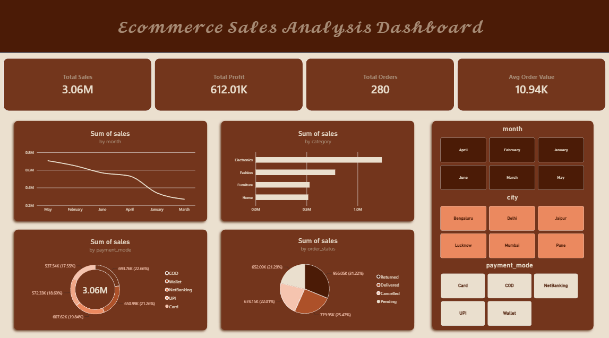

# E-commerce Sales Analysis

End-to-end data analysis project on e-commerce orders: cleaning raw data with Python, answering business questions with SQL, and presenting the results in a Power BI dashboard.

## Dashboard



## Project Overview

| Metric | Value |
|---|---|
| Total Sales | 3.06M |
| Total Profit | 612.01K |
| Total Orders | 280 |
| Avg Order Value | 10.94K |

## Workflow

1. **Data cleaning** (Python, pandas): cleaned the raw Excel data in a Jupyter notebook. Steps are documented in `reports/Steps of Cleaning.docx`.
2. **Analysis** (SQL): wrote 10 queries to answer business questions.
3. **Visualisation** (Power BI): built an interactive dashboard with filters for month, city and payment mode.

## SQL Analysis

The queries in `sql/ecommerce_analysis.sql` answer:

- What is the total revenue?
- Which cities earn the most revenue?
- Which categories bring in the most revenue?
- How many orders are cancelled or returned?
- How does revenue split across payment modes?
- What is the monthly revenue trend?
- What is the average order value (excluding cancelled and returned orders)?
- Who are the top customers by spending?
- Which products get the highest average discount?
- What is the cancellation rate by city?

## Key Insights

- **Electronics is the top category**, earning roughly 1.2M, well ahead of Fashion (~0.78M), Furniture (~0.52M) and Home (~0.51M).
- **Sales are spread evenly across payment modes**, with each of the five (Card, COD, NetBanking, UPI, Wallet) contributing between 17.5% and 22.7% of sales.
- **Order status is a concern:** no single status exceeds 31% of sales value, so over two-thirds of sales value is not from delivered orders (returned, cancelled or pending).
- **Monthly sales vary noticeably**, from about 0.27M in the weakest month to about 0.7M in the strongest.

## Tools Used

- Python (pandas, Jupyter Notebook)
- SQL (PostgreSQL)
- Power BI
- Excel

## Repository Structure

```
ecommerce-project/
├── data/        # raw and cleaned datasets
├── notebooks/   # data cleaning notebook
├── sql/         # analysis queries
├── dashboard/   # dashboard screenshot
├── reports/     # cleaning steps document
└── README.md
```

## Author

**Rida**
GitHub: [sirrida000](https://github.com/sirrida000)
